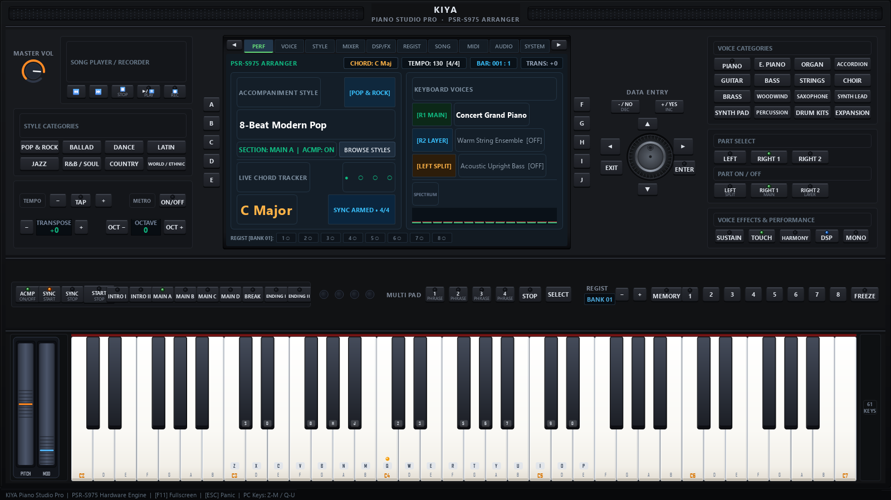

# KIYA Piano Studio Pro
## Realistic PSR-S975-Inspired Virtual Arranger Workstation



**KIYA Piano Studio Pro** is a professional desktop virtual arranger keyboard built with **Python 3.11+** and **PySide6 / Qt**. It recreates the authentic look, tactile feel, layout, and performance capabilities of a physical arranger workstation (inspired by the classic Yamaha PSR-S975 series), while preserving a high-performance native audio engine, multi-channel synthesizer, accompaniment arranger, and MIDI recording/playback.

---

## 🎹 Key Features & Hardware Layout

### 1. Realistic Hardware Chassis
- **Chassis Body**: Deep charcoal textured instrument cabinet (`#111214`) with subtle highlights, bevels, and brushed metallic seams.
- **Stereo Acoustic Speaker Wings**: Left and right acoustic mesh speaker grilles with micro-perforated acoustic patterns.
- **Workstation Proportions**: 
  - **Upper Control Panel (~55%)**: Volume knob, song transport, style categories, 7-inch color LCD display, rotary data dial, and 16 voice categories.
  - **Middle Control Strip (~17%)**: Arranger style sections (Main A–D, Intro, Fill, Break, Ending, Start/Stop), 4-jewel LED beat flasher, 4 Multi-Pads, and 8 Registration Memory slots.
  - **Lower Keybed (~28%)**: 61-key piano keyboard (C2 to C7) with red velvet felt strip, Middle C badge, split zone indicator, and left cheekblock housing spring-loaded Pitch Bend and Modulation wheels.

### 2. Central 7-Inch Recessed Color LCD Display
- High-contrast workstation aesthetic with bezel inset and tactile side softkeys `[A]`–`[E]` (left) and `[F]`–`[J]` (right), plus `[◀ TAB]` and `[TAB ▶]` navigation.
- **10 Functional Pages**:
  1. **PERF (Main Performance)**: Real-time display of Current Style, Section, Tempo BPM, Time Signature, Bar & Beat counter, Detected Harmonic Chord, Master Transpose, Right 1 Voice, Right 2 Layer, Left Split Voice, and Registration memory slots.
  2. **VOICE (Voice Browser)**: Category filter and preset selector across GM standards with direct assignment to `R1`, `R2`, or `LEFT`.
  3. **STYLE (Style Selector)**: 12 built-in musical styles with tempo and time signature.
  4. **MIXER**: 8-channel mixer strips with individual volume faders and level readouts.
  5. **DSP/FX**: Reverb processor, Chorus/Flanger, Keyboard Touch Curves (Normal, Soft, Hard, Fixed), and Harmony/Arpeggiator modes.
  6. **REGIST (Registrations)**: Memory bank manager with 8 slots per bank.
  7. **SONG**: Multi-track song recorder and MIDI player with progress tracking.
  8. **MIDI**: Hardware port status and 16-channel live activity LED matrix.
  9. **AUDIO**: Audio engine backend selector and buffer latency settings.
  10. **SYSTEM**: Master tuning (440 Hz), keyboard split point (F#3), and PC keyboard mapping reference.

### 3. Tactile Physical Push-Buttons & Jewel LEDs
- Custom-painted physical buttons with 1px top highlight, ambient drop shadow, and vertical press displacement animation.
- Integrated multi-colored jewel LEDs:
  - **Emerald Green**: Active rhythm, voice parts (`R1`), touch response.
  - **Ruby Red**: Recording arm, transport stop, ending transitions.
  - **Warm Amber**: Transition standby, sync start/stop, metronome, multi-pad.
  - **Cool Blue**: Data enter, DSP active, layer part (`R2`).

### 4. Brushed Metallic Rotary Jog Dial & Navigation Cluster
- Continuous metallic data encoder with radial knurling notches, brushed aluminum cap, and position dimple.
- Full mouse drag-to-rotate, mouse wheel increment, and keyboard navigation.
- Surrounded by `[ENTER]`, `[EXIT]`, `[▲]`, `[▼]`, `[◀]`, `[▶]`, `[- / NO]` (DEC), and `[+ / YES]` (INC) buttons.

### 5. Arranger Accompaniment Engine
- Complete accompaniment section control: `[INTRO I]`, `[INTRO II]`, `[MAIN A]`, `[MAIN B]`, `[MAIN C]`, `[MAIN D]`, `[BREAK]`, `[ENDING I]`, `[ENDING II]`, `[ACMP ON/OFF]`, `[SYNC START]`, `[SYNC STOP]`, and illuminated `[START / STOP]`.
- 4-jewel hardware LED beat flasher indicating downbeats and rhythm timing.
- Real-time harmonic chord recognition (Major, Minor, 7ths, Suspended, Diminished, Augmented, and Inversions).

### 6. Multi-Pad Performance Buttons
- 4 configurable Multi-Pads `[PAD 1]` – `[PAD 4]` with `[STOP]` and `[SELECT]`.
- Triggers real synthesizer sound events (crash cymbals, percussion grooves, brass stabs, and orchestral hits).

### 7. Registration Memory System
- Bank `-` and `+` selection.
- `[MEMORY]` arm button and 8 quick-access registration slots `[1]` – `[8]`.
- Saves and recalls complete instrument states (voices, layers, split points, transpose, active style, and tempo).

### 8. 61-Key Interactive Piano Keybed
- 61 chromatic keys (C2 to C7, MIDI notes 36 to 96).
- Warm ivory-white keys with subtle gradients, soft shadows, and rounded lip corners.
- Deep ebony black keys with top sheen and bevel highlights.
- Spring-loaded Pitch Bend wheel (auto-returns to center) and friction-held Modulation wheel (CC 1).
- Visual keyboard split zone tint and Middle C marker.
- Computer keyboard key badges printed directly on the keys.

---

## 💻 Computer Keyboard Note Mapping

You can play melodies and chords directly from your computer keyboard:

| Lower Octave Note | PC Key | Upper Octave Note | PC Key |
| :--- | :--- | :--- | :--- |
| **C3** | `Z` | **C4 (Middle C)** | `Q` |
| **C#3** | `S` | **C#4** | `2` |
| **D3** | `X` | **D4** | `W` |
| **D#3** | `D` | **D#4** | `3` |
| **E3** | `C` | **E4** | `E` |
| **F3** | `V` | **F4** | `R` |
| **F#3** | `G` | **F#4** | `5` |
| **G3** | `B` | **G4** | `T` |
| **G#3** | `H` | **G#4** | `6` |
| **A3** | `N` | **A4** | `Y` |
| **A#3** | `J` | **A#4** | `7` |
| **B3** | `M` | **B4** | `U` |
| **C4** | `,` | **C5** | `I` |

### Special Shortcuts
- **`F11`**: Toggle Fullscreen Mode.
- **`Esc`**: Panic Kill (Immediately silences all ringing and sustained notes).

---

## 🚀 Installation & Running

### Requirements
- **Python 3.11+**
- Windows 10/11 (macOS / Linux supported with compatible MIDI output)

### Setup Virtual Environment
```bash
python -m venv venv
venv\Scripts\activate
pip install -r requirements.txt
```

### Run the Application
Launch the realistic PSR-S975 hardware workstation interface:
```bash
python main.py
```

To run in classic studio dashboard mode:
```bash
python main.py --studio
```

---

## 🧪 Automated Testing

Run the automated test suite with pytest:
```bash
python -m pytest tests/
```
All 12 test modules verify:
- Physical button states and jewel LED transitions
- Rotary dial step calculation and signals
- 10-page LCD screen tab switching
- Middle strip style variation changes
- Piano keybed note triggers and pitch/mod wheels
- Audio engine, synthesizer, and split/layer routing
- Arranger accompaniment styles and real-time chord detection

---

## 📁 Project Architecture

```
PIANO GAME PY/
├── app/                      # Application lifecycle & configuration
│   ├── application.py        # KiyaApplication entry point
│   ├── config.py             # Persistent user settings
│   └── constants.py          # Sound specs, colors, and MIDI channels
├── arranger/                 # Accompaniment style & rhythm engine
│   ├── accompaniment.py      # AccompanimentCoordinator
│   ├── chord_detector.py     # Real-time harmonic chord recognition
│   ├── clock.py              # High-precision MusicalClock
│   └── style_loader.py       # Style definitions parser
├── audio/                    # Sound generation & DSP
│   ├── engine.py             # Central AudioEngine & SoundDevice stream
│   ├── midi_synth.py         # Zero-latency Windows GS Wavetable MIDI synth
│   ├── synthesizer.py        # SynthesizerFacade
│   └── dsp_synth.py          # Real-time additive/subtractive DSP synth
├── keyboard/                 # Performance note routing
│   ├── computer_keymap.py    # PC keyboard musical mapping
│   └── split_layer.py        # Split & Layer Manager (R1, R2, Left)
├── presets/                  # Voice and Registration management
│   ├── registrations.py      # RegistrationManager (Banks A-H, Slots 1-8)
│   └── voice_browser.py      # Preset sound catalog
├── ui/                       # Realistic Hardware Workstation UI
│   ├── hardware_window.py    # Master widescreen workstation window
│   ├── hardware_shell.py     # Realistic textured chassis & speaker grilles
│   ├── control_panel.py      # Upper 55% control panel assembly
│   ├── lcd_screen.py         # Central 7-inch color display & 10 pages
│   ├── physical_button.py    # Tactile push-button with jewel LEDs
│   ├── rotary_encoder.py     # Brushed metallic jog dial & nav cluster
│   ├── arranger_controls.py  # Left panel (Song, Tempo, Transpose, Volume)
│   ├── instrument_buttons.py # Right panel (16 Voice categories & Parts)
│   ├── middle_strip.py       # Middle strip (Styles, Beat LEDs, Pads, Regist)
│   ├── registration_panel.py # Registration Bank & 8 memory slots
│   ├── multipad_panel.py     # 4 Multi-Pads & sound trigger logic
│   ├── piano_keybed.py       # 61-key piano keybed with Pitch/Mod wheels
│   ├── interaction_controller.py # Central event router to audio backend
│   └── hardware_theme.py     # Hardware palette, fonts, and jewel LEDs
├── tests/                    # Automated pytest test suite
│   ├── test_hardware_ui.py
│   ├── test_audio_engine.py
│   └── test_arranger_interaction.py
├── main.py                   # Desktop application launcher
└── requirements.txt          # Python package dependencies
```

---

## 📜 License
This project is licensed under the MIT License. Original application branding: **KIYA Piano Studio Pro**.
